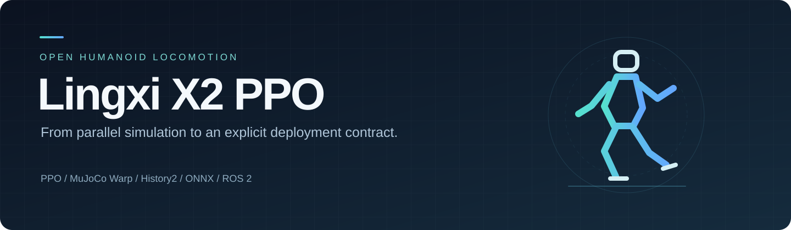
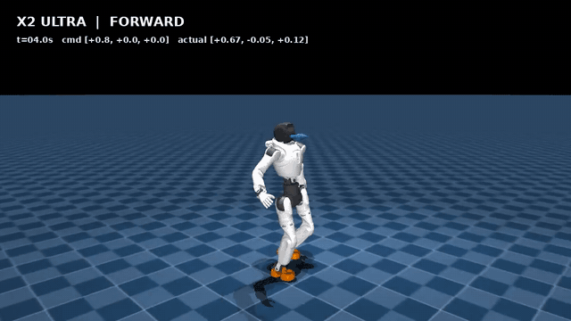
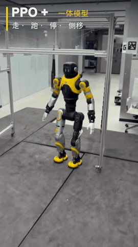
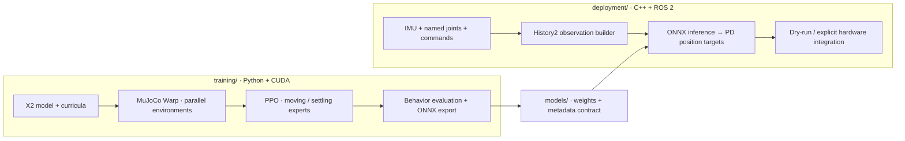

<p align="center">
  
</p>

<p align="center">
  <a href="https://github.com/topsun-bot/lingxi-x2-ppo/actions/workflows/quality.yml"></a>
  
  
  
  <a href="LICENSE"></a>
</p>

<p align="center">
  <strong>GPU-parallel locomotion learning for AgiBot Lingxi X2 Ultra.</strong><br>
  Train with PPO. Evaluate behavior. Export one ONNX. Integrate through ROS 2.
</p>

<p align="center">
  <a href="README.zh-CN.md">中文</a> ·
  <a href="#simulation-and-hardware">Demos</a> ·
  <a href="#quick-start">Quick start</a> ·
  <a href="training/README.md">Training guide</a> ·
  <a href="deployment/README.md">Deployment guide</a> ·
  <a href="models/history2_hybrid_v1/README.md">Model card</a>
</p>

## Simulation and hardware

<table>
  <thead>
    <tr>
      <th width="50%">MuJoCo simulation</th>
      <th width="50%">X2 hardware demo</th>
    </tr>
  </thead>
  <tbody>
    <tr>
      <td align="center" valign="middle">
        <a href="https://github.com/topsun-bot/lingxi-x2-ppo/releases/download/v0.1.0/simulation.mp4"></a>
      </td>
      <td align="center" valign="middle">
        <a href="https://github.com/topsun-bot/lingxi-x2-ppo/releases/download/v0.1.0/hardware.mp4"></a>
      </td>
    </tr>
    <tr>
      <td align="center">
        <strong>Released History2 Hybrid policy</strong><br>
        12-second preview · <a href="https://github.com/topsun-bot/lingxi-x2-ppo/releases/download/v0.1.0/simulation.mp4">Full video · 35 s</a>
      </td>
      <td align="center">
        <strong>Hardware experiment recording</strong><br>
        12-second preview · <a href="https://github.com/topsun-bot/lingxi-x2-ppo/releases/download/v0.1.0/hardware.mp4">Full video · 20 s</a>
      </td>
    </tr>
  </tbody>
</table>

The simulation covers standing, forward/backward and lateral walking, turns, running, braking and restarting, with commanded and measured velocities in the overlay. The hardware clip is a separately supplied experiment recording; it does not identify a policy checkpoint. [Video files and provenance](docs/media/README.md).

**Research release:** the eight archived simulation evaluations pass. Historical hardware tests achieved standing and some forward walking, but turning followed by command cancellation could still cause loss of balance. The public ROS 2 adapter needs its own hardware regression. See [validation status](docs/hardware-status.md).

## What is included

| Component | Design |
| --- | --- |
| **Learning** | PPO with separate actor/critic MLPs, observation normalization and staged behavior curricula |
| **Simulation** | Official X2 Ultra v1.3.0 geometry and inertial model, adapted for mjlab / MuJoCo Warp |
| **Temporal policy** | Two-frame, per-term history: 208 inputs → 31 joint-position residuals at 50 Hz |
| **Hybrid export** | Moving and settling experts routed inside one ONNX graph |
| **Sim-to-real work** | Gain, effort, inertia, CoM, friction, encoder and sensor-delay randomization |
| **Deployment** | Independent C++ policy core, ONNX inference and ROS 2 bridge; external AimDK messages |
| **Evidence** | Released checkpoints, checksums, raw evaluation metrics, labeled video and CPU checks |

## Architecture



Training does not import ROS 2. Deployment does not import PyTorch or require a training GPU. The shared boundary is the [ONNX metadata contract](docs/policy-contract.md): joint names, default pose, scales, gains, limits, history order and timing.

```text
lingxi-x2-ppo/
├── training/                 # PPO tasks, robot assets, curricula, evaluation/export
├── deployment/               # Standalone C++ core and ROS 2 adapter
├── models/history2_hybrid_v1/ # ONNX + both selected PyTorch checkpoints + manifest
├── docs/                     # Contracts, archived metrics, provenance and media
└── tools/                    # Release verification; used by CI
```

## Quick start

Use Linux, Python 3.12 and an NVIDIA GPU for training/simulation. The original 1,024-environment runs used a 16 GB RTX 5060 Ti. Reduce the number of environments for smaller GPUs.

```bash
git clone https://github.com/topsun-bot/lingxi-x2-ppo.git
cd lingxi-x2-ppo
python3.12 -m venv .venv
source .venv/bin/activate
python -m pip install --upgrade pip
python -m pip install torch==2.10.0 --index-url https://download.pytorch.org/whl/cu128
python -m pip install -e ./training

python tools/check_release.py --onnx
cd training
export PYTHONPATH="$PWD${PYTHONPATH:+:$PYTHONPATH}"
export MUJOCO_GL=egl
python scripts/x2_ultra/check_model.py
NUM_ENVS=16 MAX_ITERATIONS=2 scripts/x2_ultra/smoke_train.sh
```

Start a fresh policy with the factory-recorded leg gain recipe:

```bash
NUM_ENVS=1024 MAX_ITERATIONS=5001 \
  scripts/x2_ultra/train_factory_recorded_stage1_from_scratch.sh
```

The [training guide](training/README.md) covers behavior fine-tuning, temporal observation upgrade, expert export, eight evaluation configurations and video recording. The published weights involved staged training and manual checkpoint selection; this base command alone does not recreate them.

To inspect the deployment core without ROS or a GPU, run from the repository root:

```bash
./deployment/scripts/test_core.sh
```

Follow the [deployment guide](deployment/README.md) to build with ROS 2 and a separately installed AimDK SDK. Its default execution mode is dry-run. Vendor firmware, libraries and message packages are not bundled.

## Reported evaluation

Archived on **2026-09-09**, using two seeds (`42`, `7`), two command profiles and nominal/robust simulation. Each report runs 32 parallel environments.

| Metric | Archived result |
| --- | ---: |
| Complete evaluation configurations | **8 / 8 passed** |
| Behavior stage results | **120 / 120 passed** |
| Minimum per-stage survival | **100%** |
| Maximum reported stage tilt p95 | **12.21°** |
| Walking/running → stop p90, robust full sequences | **2.28–2.63 s** |
| Archived PyTorch / ONNX max absolute error | **5.96 × 10⁻⁷** |

These are results on the included simulator and test distributions, not a real-world reliability guarantee. See [evaluation details and reports](docs/evaluation.md) for definitions, reproducing commands and limitations.

## Documentation

| Topic | Reference |
| --- | --- |
| Installation, PPO and training recipes | [Training](training/README.md) · [task catalog](training/TASKS.md) |
| Build, dry-run and robot integration | [Deployment](deployment/README.md) |
| Tensor layout, action scaling and gains | [Policy contract](docs/policy-contract.md) |
| Released weights and limitations | [Model card](models/history2_hybrid_v1/README.md) |
| Simulation metrics and reproduction | [Evaluation](docs/evaluation.md) |
| Actual hardware status and next work | [Hardware status](docs/hardware-status.md) |
| Upstream revisions and artifact integrity | [Provenance](docs/provenance.md) |

## Contributing

Reproducible reports are especially useful: include the commit, task ID, gain recipe, model hash, seed and evaluation JSON. Changes to observation order, action scaling or joint mapping must update the contract and tests. See [CONTRIBUTING.md](CONTRIBUTING.md).

Current research priorities are turn-to-stop recovery, smooth expert transitions and a fuller hardware regression. Contributions to these areas are welcome.

## Credits and licensing

Built on [Unitree RL mjlab](https://github.com/unitreerobotics/unitree_rl_mjlab), [mjlab](https://github.com/mujocolab/mjlab), [MuJoCo](https://github.com/google-deepmind/mujoco), [MuJoCo Warp](https://github.com/google-deepmind/mujoco_warp) and [RSL-RL](https://github.com/leggedrobotics/rsl_rl). The X2 model comes from [AgiBot's official robot description](https://github.com/AgibotTech/agibot_x2_urdf). Hardware integration uses the separately provided [AimDK X2 SDK](https://x2-aimdk.agibot.com/zh-cn/latest/quick_start/index.html).

Project code and self-trained policy weights are released under [Apache-2.0](LICENSE). The included robot MJCF/mesh assets retain **MulanPSL-2.0**. See [third-party notices](THIRD_PARTY_NOTICES.md) for scope and modifications. This is an independent research project, without an affiliation or endorsement claim from AgiBot or Unitree.
