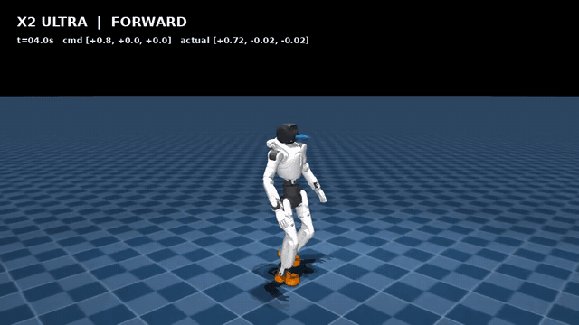
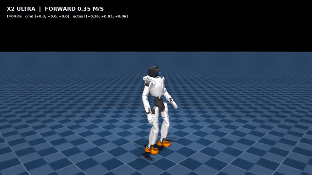

<p align="center"></p>

<p align="center">
  <a href="https://github.com/topsun-bot/lingxi-x2-ppo/actions/workflows/quality.yml"></a>
  
  
  <a href="LICENSE"></a>
</p>

<p align="center"><strong>智元灵犀 X2 Ultra 的强化学习运控训练与部署。</strong><br>并行物理仿真 → PPO 训练 → 行为验收 → ONNX 导出 → ROS 2 适配</p>

<p align="center"><a href="README.md">English</a> · <a href="training/README.md">训练指南</a> · <a href="deployment/README.md">部署指南</a> · <a href="models/history2_hybrid_v1/README.md">模型卡</a></p>

## 仿真与真机演示

<table>
  <thead>
    <tr>
      <th width="50%">MuJoCo 仿真</th>
      <th width="50%">X2 真机实拍</th>
    </tr>
  </thead>
  <tbody>
    <tr>
      <td align="center" valign="middle">
        <a href="https://github.com/topsun-bot/lingxi-x2-ppo/releases/download/v0.1.0/simulation.mp4"></a>
      </td>
      <td align="center" valign="middle">
        <a href="https://github.com/topsun-bot/lingxi-x2-ppo/releases/download/v0.1.0/hardware.mp4"></a>
      </td>
    </tr>
    <tr>
      <td align="center">
        <strong>公开的 History2 Hybrid 策略</strong><br>
        12 秒动图预览 · <a href="https://github.com/topsun-bot/lingxi-x2-ppo/releases/download/v0.1.0/simulation.mp4">完整视频 · 35 秒</a>
      </td>
      <td align="center">
        <strong>真机实验录像</strong><br>
        12 秒动图预览 · <a href="https://github.com/topsun-bot/lingxi-x2-ppo/releases/download/v0.1.0/hardware.mp4">完整视频 · 20 秒</a>
      </td>
    </tr>
    <tr>
      <th>全速走跑停 · 历史演示</th>
      <th>低速全向控制 · 历史演示</th>
    </tr>
    <tr>
      <td align="center" valign="middle">
        <a href="https://github.com/topsun-bot/lingxi-x2-ppo/releases/download/v0.1.0/simulation-full-speed.mp4"></a>
      </td>
      <td align="center" valign="middle">
        <a href="https://github.com/topsun-bot/lingxi-x2-ppo/releases/download/v0.1.0/simulation-low-speed.mp4"></a>
      </td>
    </tr>
    <tr>
      <td align="center">
        <strong>早期全速度策略 · 104 维输入</strong><br>
        12 秒动图预览 · <a href="https://github.com/topsun-bot/lingxi-x2-ppo/releases/download/v0.1.0/simulation-full-speed.mp4">完整视频 · 35 秒</a>
      </td>
      <td align="center">
        <strong>早期低速策略 · 104 维输入</strong><br>
        12 秒动图预览 · <a href="https://github.com/topsun-bot/lingxi-x2-ppo/releases/download/v0.1.0/simulation-low-speed.mp4">完整视频 · 31 秒</a>
      </td>
    </tr>
  </tbody>
</table>

仿真视频包含站立、前进、后退、左右横移、左右转向、跑步、刹停和再次起步，画面同时显示目标速度与实际速度。新增两段为早期 Kp090/Kd080 策略录像，与当前公开的 History2 Hybrid 分开标注。真机视频为另行提供的实验记录，片段未标明策略检查点。[视频文件与来源说明](docs/media/README.md)。

**当前是研究版本。** 八组归档仿真验收通过；历史真机测试实现过站立和部分前进行走，但转向后松手回零仍可能延迟失稳。开源整理后的 ROS 2 适配器需要独立完成实机回归，尚不能宣称全方向稳定行走。详见[真机状态](docs/hardware-status.md)。

## 技术与设计

| 模块 | 内容 |
| --- | --- |
| 训练 | mjlab + MuJoCo Warp 的 GPU 并行仿真，RSL-RL PPO，独立 Actor / Critic |
| 策略 | 31 关节残差位置控制；双帧、分观测项历史；208 维输入、31 维输出、50 Hz |
| 课程 | 基础步态、前后/侧移/转向、全速、停车、重启及连续换向 |
| 随机化 | Kp/Kd、力矩上限、惯量、质心、摩擦、编码器偏置和传感延迟 |
| 导出 | 行走专家与停稳专家封装为一个 ONNX，包含归一化与部署 metadata |
| 部署 | 独立 C++ 策略核心 + ONNX + ROS 2，使用外部 AimDK 消息接口 |
| 验证 | 检查点、权重哈希、8 份评测 JSON、仿真录像与自动检查 |

```text
lingxi-x2-ppo/
├── training/                  # Python：模型、任务、PPO、评测、导出
├── deployment/                # C++：策略核心、ROS 2 接口、配置和测试
├── models/history2_hybrid_v1/  # 公开 ONNX、两个专家检查点、模型卡
├── docs/                      # 策略契约、评测、来源与视频
└── tools/                     # 发布完整性检查
```

训练端不依赖 ROS，部署端不依赖 PyTorch 或训练显卡。两者通过 ONNX metadata 约定关节顺序、默认姿态、动作缩放、Kp/Kd、限位、历史排列与时序。

## 快速开始

推荐 Linux + Python 3.12 + NVIDIA GPU。历史 1,024 环境训练使用 RTX 5060 Ti 16 GB；显存较小时降低 `NUM_ENVS`。

```bash
git clone https://github.com/topsun-bot/lingxi-x2-ppo.git
cd lingxi-x2-ppo
python3.12 -m venv .venv
source .venv/bin/activate
python -m pip install --upgrade pip
python -m pip install torch==2.10.0 --index-url https://download.pytorch.org/whl/cu128
python -m pip install -e ./training

python tools/check_release.py --onnx
cd training
export PYTHONPATH="$PWD${PYTHONPATH:+:$PYTHONPATH}"
export MUJOCO_GL=egl
python scripts/x2_ultra/check_model.py
NUM_ENVS=16 MAX_ITERATIONS=2 scripts/x2_ultra/smoke_train.sh
```

用实录腿部 Kp/Kd 配方从零训练：

```bash
NUM_ENVS=1024 MAX_ITERATIONS=5001 \
  scripts/x2_ultra/train_factory_recorded_stage1_from_scratch.sh
```

完整课程、双帧升级、专家微调、导出和录制命令见[训练指南](training/README.md)。发布模型经历多阶段训练与人工挑选检查点，基础训练一条命令并不等于复现最终权重。

无需 ROS 即可验证部署核心，在仓库根目录执行：

```bash
./deployment/scripts/test_core.sh
```

ROS 2 构建、dry-run 和真机接口见[部署指南](deployment/README.md)。默认运行不发布关节命令；厂商 SDK、固件和消息包需独立安装。

## 仿真验收

归档日期 **2026-09-09**。随机种子为 `42`、`7`，每份报告 32 个并行环境；覆盖全速/低速两组命令和 nominal/robust 两类仿真配置。

| 指标 | 归档结果 |
| --- | ---: |
| 完整评测配置 | **8 / 8 通过** |
| 行为阶段结果 | **120 / 120 通过** |
| 最低单阶段生存率 | **100%** |
| 阶段倾角 p95 最大值 | **12.21°** |
| 鲁棒全速序列行走/跑步后停稳 p90 | **2.28–2.63 s** |
| 归档 PyTorch / ONNX 最大绝对误差 | **5.96 × 10⁻⁷** |

以上为指定仿真分布内的结果。[评测说明](docs/evaluation.md)提供原始指标、复现方式及局限；[策略契约](docs/policy-contract.md)解释动作缩放、归一化、双帧顺序和增益来源；[来源记录](docs/provenance.md)记录上游版本、许可证及发布物哈希。

## 后续方向与贡献

重点是转向后停稳、专家分支平滑切换和更完整的实机回归。欢迎提交能复现的评测：请附 commit、任务 ID、增益配方、模型 SHA、随机种子与 JSON 结果，详见[贡献指南](CONTRIBUTING.md)。

基于 Unitree RL mjlab、mjlab、MuJoCo Warp 与 RSL-RL。X2 模型来自 AgiBot 官方机器人描述。项目代码和自训练权重采用 [Apache-2.0](LICENSE)，机器人 MJCF/mesh 资产保留 **MulanPSL-2.0**，具体归属与修改见[第三方声明](THIRD_PARTY_NOTICES.md)。本项目为独立研究项目，不代表机器人厂商的官方产品或背书。
